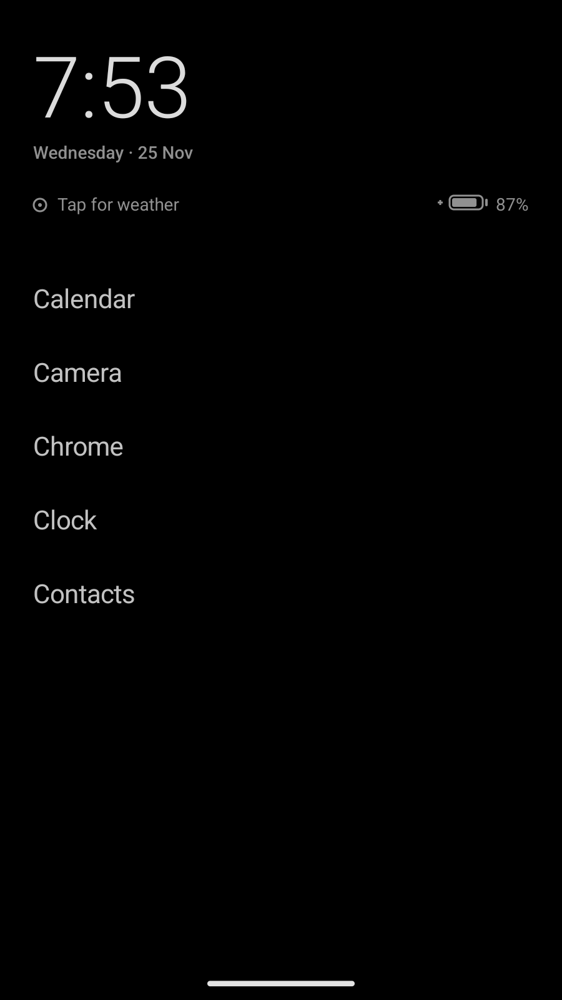
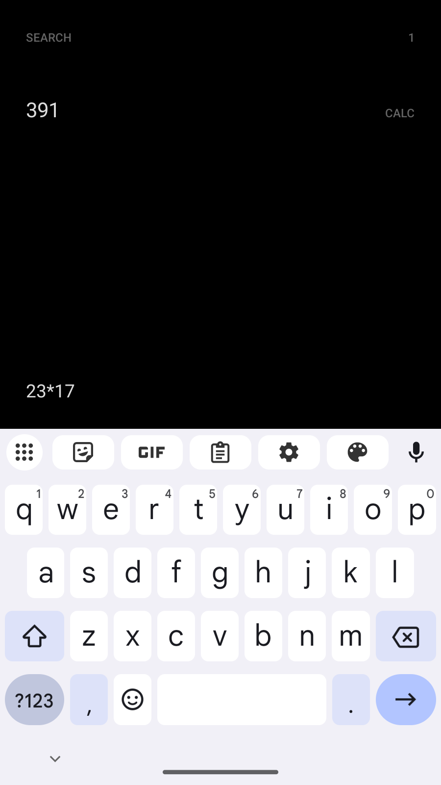
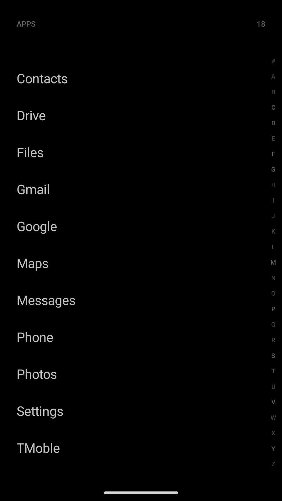
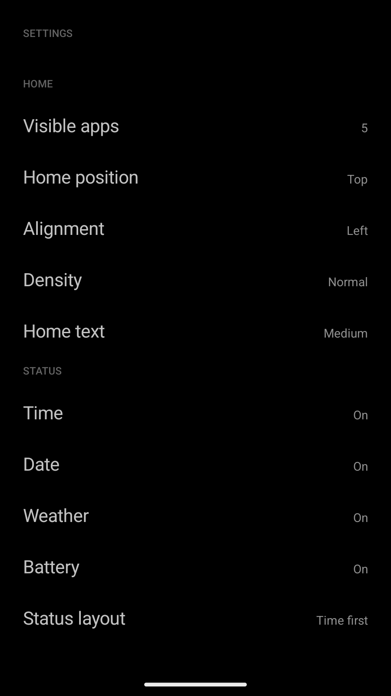
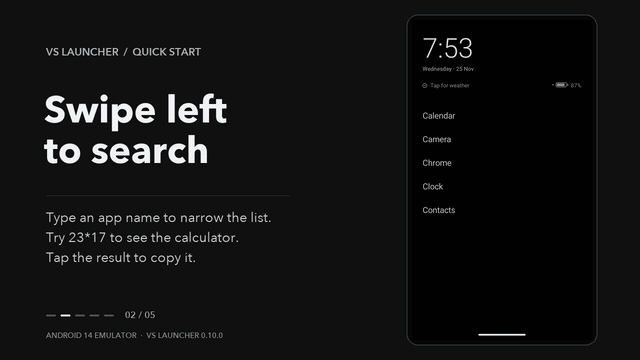

<div align="center">
  
  <h1>VS Launcher</h1>
  <p>A text-first Android home screen with favorites, swipe-to-search, and an alphabetical app list.</p>
  <p>
    <a href="https://github.com/Ni-zav/vs-launcher/releases/latest"></a>
    
    <a href="https://github.com/Ni-zav/vs-launcher/actions/workflows/android.yml"></a>
    <a href="LICENSE"></a>
  </p>
  <p><strong><a href="https://github.com/Ni-zav/vs-launcher/releases/download/v0.10.0/VS-Launcher-0.10.0-debug.apk">Download APK</a></strong> · <a href="#quick-start">Quick start</a> · <a href="#walkthrough">Walkthrough</a></p>
</div>

## Screenshots

<p align="center">
  <a href="docs/media/home.png"></a>
  <a href="docs/media/search.png"></a>
  <a href="docs/media/apps.png"></a>
  <a href="docs/media/settings.png"></a>
</p>

<sub>Left to right · Home, Search, Apps, Settings. Captured using VS Launcher 0.10.0 on an Android 14 emulator.</sub>

## Quick start

1. Download the [0.10.0 APK](https://github.com/Ni-zav/vs-launcher/releases/download/v0.10.0/VS-Launcher-0.10.0-debug.apk) to a device running **Android 8.0 or newer** and open it. If Android prompts you, allow installation from the app that opened the file.
2. Go to **Settings → Apps → Default apps → Home app** and select **VS Launcher**. The path can vary by device.
3. Press **Home** to start. Choose another Home app from the same Android settings menu whenever you want to switch back.

Upgrading from the published 0.9.1 APK requires a clean install because the signing key changed. Export your configuration in launcher Settings before uninstalling, then import it in 0.10.0. [Upgrade and release notes](docs/releases/0.10.0.md)

| What you want to do | How to do it |
| --- | --- |
| Find an app | Swipe left on Home and type. Tap a result or press Go to open the first result. A single app match can open automatically after a short pause. |
| Browse all apps | Scroll the Apps list to collapse the keyboard. Drag the `#–Z` rail to jump between letters. Tap **APPS** to search again. |
| Change a favorite | Long-press a Home row to change, rename, move, or clear it. Tap **+ ADD APP** when a slot is empty. |
| Customize Home | Swipe right on Home. Tap a setting to toggle it or cycle through its choices. |
| Open a favorite with a gesture | Set **Swipe up** in launcher Settings, then swipe up on Home. |
| Run a utility | In Search, try `23*17`, `10km to mi`, `timer 10m`, `alarm 07:30`, or `wifi`. Tap the utility result or press Go. Calculations and conversions can be copied. |
| Open the in-app guide | Search for `help` or use **Settings → How to use**. |

## Walkthrough

<a href="https://github.com/Ni-zav/vs-launcher/releases/download/v0.10.0/VS-Launcher-0.10.0-walkthrough.mp4"></a>

[Download the 45-second MP4](https://github.com/Ni-zav/vs-launcher/releases/download/v0.10.0/VS-Launcher-0.10.0-walkthrough.mp4). The on-screen instructions cover choosing VS Launcher as Home, search and calculator, alphabetical browsing, favorite management, and swipe-up quick launch.

## Features

- **A configurable Home screen.** Keep up to eight favorites, rename or reorder them, and adjust alignment, density, and text size. Time, date, battery, and weather each have a visibility toggle.
- **Search and shortcuts.** Find apps by name, alias, or initials. Use the same field for calculations, timers, alarms, links, and Android settings shortcuts.
- **Android profiles.** Work apps and Android 15 Private Space appear when Android exposes the corresponding profile.
- **Portable settings.** Export and import the launcher configuration as JSON through Android’s document picker.

VS Launcher uses Android platform APIs, a native Canvas, and on-device app search. It requires no account. Weather sends rounded coordinates to Open-Meteo if you grant approximate location. Coordinates are kept out of the weather cache. [Open-Meteo](https://open-meteo.com/) · [Implementation and privacy details](docs/IMPLEMENTATION.md)

## Build from source

Use JDK 17, Android SDK 35 with Build Tools 35.0.0, and Gradle 8.7.

```sh
bash scripts/build-debug-apk.sh
```

The script writes `dist/VS-Launcher-0.10.0-debug.apk`. You can also download the `vs-launcher-debug-apk` artifact from a successful [Android CI run](https://github.com/Ni-zav/vs-launcher/actions/workflows/android.yml).

[Build and signing guide](docs/BUILD_APK.md) · [Implementation](docs/IMPLEMENTATION.md) · [Benchmarks](docs/BENCHMARK.md) · [0.9.1 audit](docs/AUDIT.md) · [Changelog](CHANGELOG.md)

## License and assets

VS Launcher is licensed under the [Apache License, Version 2.0](LICENSE). The [VS icon source](art/launcher-icon.svg) and [Android adaptive icon resources](app/src/main/res/mipmap-anydpi-v26/) are part of this repository. The demo captures show Android system UI and stock apps for illustration.
